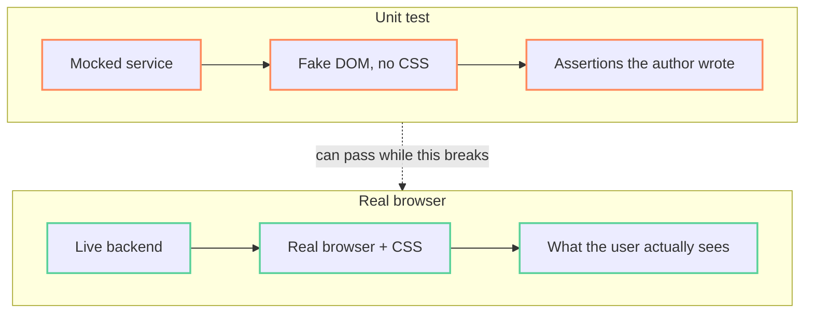

A green build and passing unit tests do not prove a UI change works. Tests run against mocked data and a fake DOM, and they only check what someone thought to assert. Proof means you drive the real page in a real browser and post what you saw on the review.

This post is the method I use, plus real evidence I captured from this site while I wrote it. The contact sheets caught two problems that the DOM assertions alone did not show. At the end there is a prompt you can give your coding agent to build the same check for your app.

## TL;DR

1. **Screenshots prove states.** Use one per state: default, empty, error, and each option of a changed control.
2. **Screencasts prove transitions.** These are hover reveals, reorders, open/close and drag. A still image shows only the end state.
3. **Pair every picture with an assertion.** For example, read the rendered values out of the DOM. The picture shows something happened. The assertion shows it was the right thing.
4. **Make the clip easy to watch.** Hold each state on screen, re-encode to a codec every browser plays, check a contact sheet of frames before you post, and caption every action. The real mouse pointer is not recorded, so draw one in the page when the viewer needs to see it.

## What each kind of evidence proves

| Evidence | Proves | Misses |
|---|---|---|
| Unit / component tests | Logic and bindings the author thought to assert | Real data, real CSS, real browser events, anything not asserted |
| Screenshot | A state rendered with real data and real styles | Anything that happens *between* states |
| Screencast clip | A transition happened, in order, with no flash or wrong frame | The exact values; the pointer and keys that caused it |
| DOM / network assertion | The exact values the user sees | What it looks like |

Each kind covers what the others miss. Use the cheapest set that covers every claim the change makes. Tick the claims your change makes:

<div data-chart="evidence-picker">Interactive: pick the claims a UI change makes and see which evidence covers them. Enable JavaScript to view.</div>

## Why tests alone miss UI regressions



- **Mocks return canned data.** A test can pass while real data never reaches the view.
- **There is no CSS or real layout.** Hover-only controls, overflow, alignment and z-index bugs do not exist in a fake DOM.
- **Weak assertions pass by accident.** A spec clicks the "Type" column header and expects rows `[B, A]`. If the previous sort already produced `[B, A]`, the test passes even when the Type header does nothing.
- **One state looks like another.** An end-state screenshot of a sorted table looks the same whether the sort ran or the list was already in that order.

## Real evidence from this site

To show the method, I verified the bar chart in my [interactive charts post](https://dalenguyen.me/blog/2026-06-14-interactive-charts-analogjs-markdown) on the live site. A tooltip shows when you hover a bar. A hover reveal is a good test case: a still image cannot show that the hover caused it. I used [chrome-devtools-mcp](https://github.com/ChromeDevTools/chrome-devtools-mcp) from Claude Code to drive the page, take screenshots and record the screencast.

The images below are captures. They are not live widgets.

### Two screenshots: one per state

Default. No tooltip:

<figure style="margin:1.5rem 0;padding:10px 10px 4px;border:1px dashed #6e7681;border-radius:12px"><figcaption style="margin:0 0 8px;font-size:12px;letter-spacing:.06em;text-transform:uppercase;color:#9aa7b5">Screenshot · captured from dalenguyen.me, not interactive</figcaption></figure>

Hover on the Next.js bar. The tooltip shows the exact value:

<figure style="margin:1.5rem 0;padding:10px 10px 4px;border:1px dashed #6e7681;border-radius:12px"><figcaption style="margin:0 0 8px;font-size:12px;letter-spacing:.06em;text-transform:uppercase;color:#9aa7b5">Screenshot · captured from dalenguyen.me, not interactive</figcaption></figure>

Each picture has a DOM check. After each hover, the script read the tooltip text from the widget's shadow root and compared it with the chart data (12, 24 and 18 ms). The tooltip's line break is shown as "·":

```json
[
  "(no tooltip)",
  "Analog · Median render (ms): 12 ms",
  "Next.js · Median render (ms): 24 ms",
  "SvelteKit · Median render (ms): 18 ms",
  "(no tooltip)"
]
```

### One clip: the transition

**Recording: hover Analog → hover Next.js → hover SvelteKit → move the pointer off the chart.** The real pointer is not recorded, so the script draws one. It moves the drawn cursor to each bar, then fires the hover there.

<figure style="margin:1.5rem 0;padding:10px 10px 4px;border:1px dashed #6e7681;border-radius:12px"><figcaption style="margin:0 0 8px;font-size:12px;letter-spacing:.06em;text-transform:uppercase;color:#9aa7b5">Recording (MP4) · captured from dalenguyen.me, not interactive</figcaption><video src="assets/images/blog/visual-evidence-hover.mp4" controls muted loop playsinline width="100%"></video></figure>

The same clip as a GIF, which plays without a click:

<figure style="margin:1.5rem 0;padding:10px 10px 4px;border:1px dashed #6e7681;border-radius:12px"><figcaption style="margin:0 0 8px;font-size:12px;letter-spacing:.06em;text-transform:uppercase;color:#9aa7b5">Recording (GIF) · captured from dalenguyen.me, not interactive</figcaption></figure>

For scale: this 8.8-second clip is 86 KB as H.264 MP4 and 363 KB as GIF. The recorder wrote AV1 at 1440×1800, which some browsers cannot play.

### Failure 1: every assertion passed, and the clip showed nothing

My first recording for this post looked fine in the logs. All five DOM checks passed. Then I made the contact sheet. Here is the same problem again on the bar chart, after I cleared the dialog's "dismissed" flag:

<figure style="margin:1.5rem 0;padding:10px 10px 4px;border:1px dashed #6e7681;border-radius:12px"><figcaption style="margin:0 0 8px;font-size:12px;letter-spacing:.06em;text-transform:uppercase;color:#9aa7b5">Contact sheet · captured from dalenguyen.me, not interactive</figcaption></figure>

My own newsletter dialog opened over the page and covered the chart for the whole clip. The assertions read the DOM under the dialog, so they could not see it. A reviewer would get a 7-second video of a sign-up form. That is why you check the contact sheet before you post.

### Failure 2: no hold time

Then I ran the same flow with no waits between hovers. The contact sheet, at 4 frames per second this time:

<figure style="margin:1.5rem 0;padding:10px 10px 4px;border:1px dashed #6e7681;border-radius:12px"><figcaption style="margin:0 0 8px;font-size:12px;letter-spacing:.06em;text-transform:uppercase;color:#9aa7b5">Contact sheet · captured from dalenguyen.me, not interactive</figcaption></figure>

Two problems:

- **No tooltip appears in any frame.** The whole flow ran between two frames. The clip is 1.8 seconds of a chart with no tooltip.
- **The DOM checks failed too.** Each read came back as "(no tooltip)", because the script read the DOM before Angular rendered. Without waits, assertions can read a stale state. On an earlier try with a stepper widget, the same cause made a click do nothing: the button was still disabled from the previous render.

So the waits are not only for the viewer. They also give the page time to render before the next action or check. Slide the hold time and see which states a 1-frame-per-second contact sheet keeps:

<div data-chart="hold-timer">Interactive: slide the hold time per step and see which states appear in the contact sheet. Enable JavaScript to view.</div>

## Lessons learned

1. **Verify in the real browser against real data before you call a UI change done.** Specs prove the logic you asserted. Only the live page proves what the user sees.
2. **Screenshot every state and every option of a changed control.** If a change touches one option of a control (one column, one tab, one field type), the user sees all of them, so check all of them.
3. **Record a clip when the change is about motion or interaction.** Hover, drag, open/close, sort, reorder and animation need a clip.
4. **Pair each picture with a value check.** After you sort by date, read the date column from the DOM and confirm the order.
5. **Caption every action in a clip.** Screen recordings capture the page, not the pointer. When the viewer must see where an action happened, draw a cursor in the page during the recording.
6. **Hold each state for about a second.** Automation acts in milliseconds.
7. **Check against a baseline before you blame the change.** When the console shows an error, load the same page on a build without the change. If the error is there too, it is not part of this review.
8. **Keep evidence out of the repo, and post one evidence comment per review.** Upload the files to the review, then delete them locally. When you verify again, edit the comment. Do not post a second one.

## Build your own verification skill

Copy this prompt into your coding agent (Claude Code, Codex, Cursor or similar). The agent reads your repo and writes a skill for your stack. After that, you can ask it to "verify this UI change" and get the same evidence as above.

````text
Build a reusable skill for this repo named "verify-ui". It verifies a frontend
change in a real browser and produces visual evidence for the code review.
Before you write it, read the repo: find how to start the app, the URL and port,
how to sign in with a test account, and which browser automation tool I have
(chrome-devtools-mcp, Playwright, Puppeteer, or another). Ask me if any of
these is unclear. Save the skill where this agent loads skills from (for Claude
Code: .claude/skills/verify-ui/SKILL.md).

The skill must do these steps, in this order:

1. List the claims. Read the diff and list every claim the change makes:
   a new state, each option of a changed control, a transition (hover, sort,
   open/close, drag, animation), exact values on screen, no new console errors.
   Map each claim to evidence: state = screenshot, option = one screenshot per
   option, transition = captioned clip, values = DOM or network check,
   console = compare with a baseline build.

2. Drive the real page. Open {APP_URL}/{PAGE} with real data on the known test
   account. Close any dialog, cookie banner or toast that covers the region,
   and check that none is open before each capture.

3. Screenshots. One per state, cropped to the region that changed. Number the
   files in walkthrough order: 01-default.png, 02-hover.png, and so on. If the
   tool only takes viewport shots, crop with ffmpeg and multiply the element
   box by devicePixelRatio.

4. Value checks. After each action, read the rendered values from the DOM
   (look inside shadow roots too) and compare them with the expected data.
   Wait for the page to render before each read, or the read gets a stale state.

5. Clip. One flow per clip, 5-15 seconds. Run the whole flow as one script in
   the page: wait 1.2 s, then for each step do the action and wait 1.3 s.
   Synthetic events do not move the real pointer, and the recorder does not
   capture it. When the viewer needs to see where an action happens, add a
   temporary cursor element to the page (position fixed, pointer-events none,
   top z-index, CSS transition on transform). Move it to the target, wait
   about 550 ms, then fire the event at the same x, y. Remove it after.

6. Convert. The recorder can write AV1 at full device resolution, which some
   browsers cannot play. Re-encode to H.264:

   ```
   ffmpeg -v error -y -i raw/03-flow.mp4 -c:v libx264 -pix_fmt yuv420p -crf 23 -vf "scale=1600:-2" -movflags +faststart -an 03-flow.mp4
   ```

   For clips under 10 s, also make a GIF:

   ```
   ffmpeg -v error -y -i raw/03-flow.mp4 -vf "fps=10,scale=1000:-1:flags=lanczos,split[a][b];[a]palettegen=stats_mode=diff[p];[b][p]paletteuse=dither=bayer:bayer_scale=5" 03-flow.gif
   ```

7. Contact sheet. Make one and look at it before you post anything:

   ```
   ffmpeg -v error -y -i 03-flow.mp4 -vf "fps=2,scale=450:-1,tile=4x4" -frames:v 1 contact.png
   ```

   Every state in the caption must appear in a frame, and nothing may cover
   the region. If a state is missing, record again with longer waits. If
   something covers the region, close it and record again. A passing DOM
   check does not prove the picture is right.

8. Baseline. If the console shows an error, load the same page on a build
   without the change. If the error is there too, report it as pre-existing.

9. Report. Write one review comment: environment, test account and commit
   SHA; one numbered heading per screenshot; each clip captioned action by
   action (for example "hover Analog, then hover Next.js, then leave");
   an "Also verified" list with the value checks and the console result.
   Show me the comment before you post it. When I ask to verify again,
   edit that comment instead of posting a new one.

10. Clean up. Keep all captures in a folder git ignores (add .review-snaps/
    to .git/info/exclude so the rule is not committed). Delete the folder
    after the evidence is uploaded.

Finish by running the skill once on a small UI flow in this repo. Show me the
screenshots, the contact sheet and the draft comment, so I can check the skill
works.
````

The prompt gives the agent the parts that are hard to know in advance: the hold times, the codec, the contact sheet check and the drawn cursor. The agent fills in your app URL, test account and browser tool from your repo.

## Pitfalls

- **Something covers the page.** A dialog, cookie banner or toast covers the region, and the DOM checks still pass. Check the contact sheet.
- **Clicks look instant in the clip.** Without waits, a 5-step flow fits in half a second. Add the waits.
- **A click hits a stale state.** With no waits, the script can click before the page re-renders. Wait after each action.
- **The clip plays for you and not for the reviewer.** It is usually the codec. Re-encode to H.264 `yuv420p`.
- **The hover state disappears in a screenshot.** Taking the screenshot can fire a mouse-leave event. Hover right before the shot, and check the image.
- **A test passes because the order was already right.** When a test asserts a reorder, start from a state where the expected order differs from the current one.

## Quick checklist

- [ ] Unit tests green, **and** the page driven live against real data
- [ ] One screenshot per state, and per option of every changed control
- [ ] One clip per interactive flow
- [ ] Each state held about 1 s in the recording
- [ ] Clip re-encoded to H.264 `yuv420p` with `+faststart`; GIF only for clips under 10 s
- [ ] Contact sheet checked: every captioned state appears, nothing covers the region
- [ ] Each picture paired with a DOM or network value check
- [ ] Console errors compared against a baseline build
- [ ] One evidence comment, each clip captioned action by action
- [ ] Local snapshots and clips deleted; nothing committed

> Tests prove the logic you asserted. A screenshot proves the state the user sees. A captioned, re-encoded screencast proves the motion between states. Post all three before you call a UI change done.
